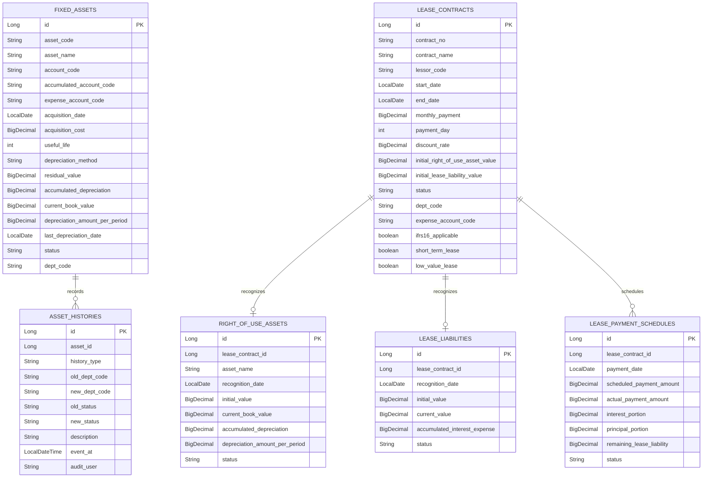

# asset-lease schema

## 핵심 ERD

## 주요 상태

| 모델 | 상태 | 의미 |
| --- | --- | --- |
| `FixedAsset` | `ACTIVE` | 상각 대상 자산 |
| `FixedAsset` | `FULLY_DEPRECIATED` | 장부가액이 잔존가치까지 내려간 자산 |
| `FixedAsset` | `DISPOSED` | 처분 완료 자산 |
| `LeaseContract` | `ACTIVE` | 유효한 리스 계약 |
| `LeaseContract` | `TERMINATED` | 종료된 계약 |
| `LeaseContract` | `MODIFIED` | 조건 변경 이력이 있는 계약 |
| `LeasePaymentSchedule` | `SCHEDULED` | 예정된 지급 회차 |
| `LeasePaymentSchedule` | `PAID` | 월별 회계처리에서 반영된 회차 |
| `LeasePaymentSchedule` | `CANCELLED`, `ADJUSTED` | 취소 또는 조정 확장 지점 |

## 코드 기반 외부 참조

- `accountCode`, `accumulatedAccountCode`, `expenseAccountCode`: master-data 계정과목 코드.
- `departmentCode`: 관리 부서 코드.
- `lessorCode`: 리스 제공자 거래처 코드.
- `AssetSourceDocumentProvider`: `FIXED_ASSET`, `IFRS16_LEASE` 원천 문서 조회를 제공한다.

도메인 엔티티는 master-data 엔티티를 직접 들고 있지 않고 코드만 저장한다. 실행 앱은 `AssetLeaseApiApplication`과 `AssetLeaseBatchApplication`으로 분리되어 있으며, 두 앱은 로컬 통합 실행을 위해 master-data repository/entity를 함께 스캔한다.

## migration 주의사항

`core/src/main/resources/db/migration/V20__init_asset_lease.sql`과 `docs/db/schema.sql`은 스키마 참고 자료다. 현재 `application.yml`은 `spring.jpa.hibernate.ddl-auto=update`를 사용하므로 로컬 실행에서는 JPA 엔티티 기준으로 테이블이 보정될 수 있다.

운영에서 Flyway를 활성화하려면 아래 항목을 먼저 맞춰야 한다.

- `LeaseContract` 엔티티의 `paymentDay`, `expenseAccountCode`, `shortTermLease`, `lowValueLease` 컬럼 반영 여부.
- `RightOfUseAsset`, `LeaseLiability` 테이블 생성 migration 존재 여부.
- `LeasePaymentSchedule`의 join column 명칭과 migration의 `contract_id` 명칭 일치 여부.
- `AssetJdbcAdapter`가 갱신하는 `updated_at` 컬럼과 `status` 컬럼이 실제 운영 테이블에 존재하는지 여부.

## 정합성 체크 포인트

- 금액 계산은 `BigDecimal`을 사용한다.
- 고정자산 상각은 장부가액이 잔존가치 아래로 내려가지 않도록 `FixedAsset.calculateDepreciation`과 `FixedAsset.depreciate`에서 보정한다.
- 단건 API의 `depreciate`는 엔티티 상태를 변경하고, 대량 Batch의 `calculateDepreciation`은 결과 값만 만들어 JDBC bulk update가 한 번만 반영한다.
- 자산 변경은 `AssetHistory`에 감사 이력을 남긴다.
- 리스 지급 스케줄은 이자, 원금, 잔여 리스부채를 회차별로 보관한다.
- 리스 회계 계정 코드는 `LeaseAccountMappingPort` 뒤로 분리되어 설정/정책 어댑터에서 가져온다.

## V21 재측정 원천 영수증 (GH-955)

두 dialect 경로의 `V21__lease_remeasurement_receipts.sql`은 새 `lease_remeasurement_receipts` 테이블을 만든다. 게시된 V20은 수정하지 않는다. `(contract_no, operation_id)` unique와 계약 FK, fingerprint version 1 CHECK로 원천 업무 변경을 보존한다. 원 요청 hash와 원 금융 이벤트 금액·일자·부서·actor를 같은 계약 잠금 트랜잭션에 기록한다. 도메인 receipt는 순수 Java이며 JPA entity와 변환은 infrastructure에서 담당한다. API/Batch entity scan은 새 infrastructure entity를 포함한다.

배포는 해당 서비스의 migration context에서 V21 적용 후 새 writer를 실행한다. 이전 writer는 operationId/receipt를 만들지 않으므로 재측정 트래픽을 중지하고 교체한다. H2 테스트는 PostgreSQL dialect baseline+V21과 Journal 전용 migrations를 검증한다. 실제 PostgreSQL 배포 검증은 별도 게이트다. 롤백은 검토된 코드 revert 또는 forward correction이며 금융 receipt/기존 전표/이력 테이블을 삭제하지 않는다. 이 테이블은 전송 outbox가 아니다.
