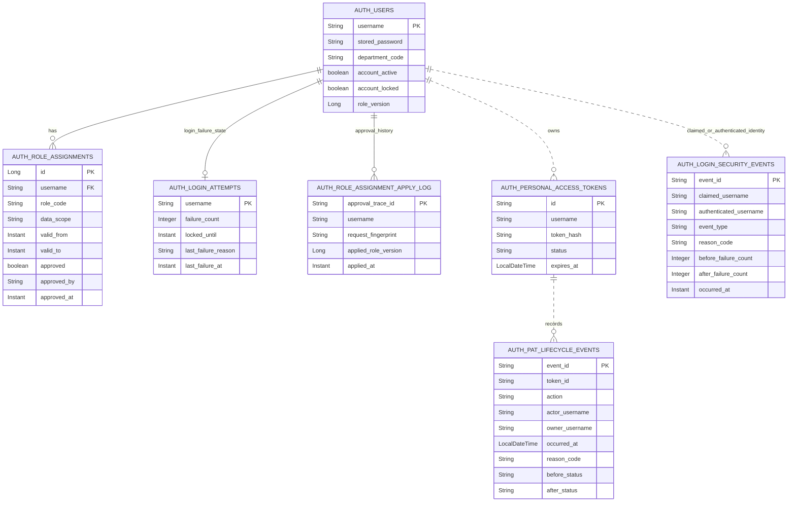

# auth schema

## 핵심 테이블

Flyway V70~V75 기준으로 Auth는 사용자, 역할, 로그인 실패, 승인 반영 이력과 Personal Access Token 및 보안 이벤트 감사를 저장합니다.



점선은 username/token ID의 논리적 연결을 나타냅니다. V73·V74에는 해당 외래 키가 없어 감사 이력은 향후 PAT 행을 정리해도 유지됩니다.

## 마이그레이션 책임

| 버전 | 책임 |
| --- | --- |
| `V70` | `auth_users`, `auth_role_assignments`와 조회 인덱스 |
| `V71` | 여러 Auth 인스턴스가 공유하는 로그인 실패/잠금 상태 |
| `V72` | Governance 역할 승인 재시도를 막는 멱등 수신 이력 |
| `V73` | Personal Access Token 해시와 만료/폐기 상태 |
| `V74` | PAT 생성·폐기 감사 이벤트와 PAT 소유자 username 길이(80자) 정합화 |
| `V75` | PAT 사유/전후 상태, 로그인 실패·성공 전이 이벤트. 기존 V74 행은 사유 `LEGACY_ACTION`, 상태 `UNKNOWN`으로 표시하여 추측한 이력을 만들지 않음 |

## 주요 설정

| 설정 | 기본값 | 의미 |
| --- | --- | --- |
| `AUTH_PERSISTENCE_MODE` | `jpa` | JPA 또는 memory 사용자/역할 어댑터 |
| `AUTH_INTERNAL_API_TOKEN` | 없음(필수 실행 입력) | 내부 역할 반영 API 토큰. local도 실행 시 임시 값을 주입 |
| `AUTH_MASTER_DATA_BASE_URL` | `http://localhost:8082` | 부서 코드 검증용 master-data 주소 |
| `AUTH_LOGIN_MAX_FAILURES` | `5` | 잠금 전 연속 실패 횟수 |
| `AUTH_LOGIN_LOCK_DURATION_MINUTES` | `15` | 임시 잠금 시간 |
| `AUTH_LOGIN_SECURITY_STORE` | `jpa` | 로그인 상태와 영속 감사 이벤트 저장소. `memory`는 명시적 로컬 학습 모드 |
| `AUTH_JWT_SECRET` | 없음(필수 실행 입력) | JWT 서명키. local도 실행 시 임시 값을 주입하며 HS256 기준 32바이트 이상 필요 |
| `AUTH_JWT_ISSUER` | `auth-service` | JWT issuer |
| `AUTH_JWT_EXPIRATION_SECONDS` | `3600` | JWT 최대 수명. 2초 이상 필수. 포함된 역할의 가장 이른 `validTo`가 더 빠르면 그 시각으로 단축 |

## 상태와 정합성 정책

- 역할 교체는 기존 행을 새 승인 목록으로 바꾸고 `roleVersion`을 1 증가시킵니다.
- 같은 `approvalTraceId`와 fingerprint 재시도는 버전을 증가시키지 않습니다.
- 같은 trace의 내용이 달라지면 승인 오염으로 보고 거부합니다.
- `validFrom`은 포함, `validTo`는 제외하는 반개구간으로 역할 유효성을 판단합니다.
- token-version 검증은 버전뿐 아니라 계정 활성/관리 잠금/유효 역할도 확인합니다.
- PAT 소유자는 `AuthUser.username`과 대소문자까지 정확히 일치해야 합니다. 감사 이력은 행위자와 소유자를 별도로 저장하며 원문 토큰이나 해시를 기록하지 않습니다.
- `auth_login_attempts.username` 기본키가 사용자별 실패·성공 상태 전이의 잠금 대상입니다. 만료된 행은 읽기 중 삭제하지 않고 다음 실패에서 1회로 재시작하며, 성공은 현재 활성 잠금을 지우지 않습니다. 별도 스키마 변경은 필요하지 않습니다.

## 보안 감사 소유권·보존·내보내기

Auth 운영 담당자가 `auth_pat_lifecycle_events`와 `auth_login_security_events`의 보존 및 내보내기를 소유합니다. 두 테이블은 애플리케이션에서 append-only로 쓰고 자동 삭제 작업을 제공하지 않습니다. 운영 보존 기준은 **최소 7년**이며, 실제 보존/폐기 및 법적 보존 요청은 조직 정책에 따라 별도 승인합니다. 감사 행을 일반 PAT·로그인 상태 정리 작업에 포함하지 않습니다.

운영 설정은 `AUTH_LOGIN_SECURITY_STORE=jpa`와 `AUTH_PERSISTENCE_MODE=jpa`를 사용해야 합니다. `memory` 로그인 저장소는 로컬 학습용으로 DB 감사 이벤트를 남기지 않습니다. 인증 전 실패의 `claimed_username`은 입력을 정규화한 주장된 식별자일 뿐 확인된 행위자가 아닙니다. `authenticated_username`은 성공에만 기록합니다. PAT 폐기는 검증된 JWT 행위자와 토큰 소유자를 분리하여 기록하고 관리자 요청의 `X-Audit-Reason`은 필수이며 `ADMIN_SECURITY`, `ADMIN_OFFBOARDING`, `ADMIN_ROTATION` 중 하나만 받습니다. 원문 토큰·해시·비밀번호·OTP·임의 자유 텍스트는 이벤트 열에 저장하지 않습니다.

운영 내보내기는 감사 전용 읽기 권한으로 `event_id`, 식별자, 이벤트 종류, 사유 코드, 전후 상태, `occurred_at`만 기간순으로 조회합니다. 안정적인 페이지 경계는 `(occurred_at, event_id)`입니다. 내보낸 파일과 행 수·최초/최종 시각·SHA-256 해시를 함께 기록하고 접근 제한된 불변 저장소에 보관합니다. 예를 들어 로그인 이벤트는 다음 조회를 사용합니다.

체크섬을 재현할 때는 조회 순서대로 각 열을 UTF-8 바이트 길이와 `:` 및 값으로 연결하고, SQL null은 `-1:`로 표시하며 행 사이에는 LF 한 바이트만 둡니다(마지막 LF 없음). 시각은 DB에서 읽은 `LocalDateTime`의 ISO 문자열로 고정합니다. 이 바이트열의 SHA-256을 매니페스트에 기록합니다. 길이 접두사로 필드 경계를 구분하므로 값에 구분 문자가 포함되어도 재계산이 가능합니다.

```sql
SELECT event_id, claimed_username, authenticated_username, event_type, reason_code,
       before_failure_count, after_failure_count, before_locked_until, after_locked_until, occurred_at
FROM auth_login_security_events
WHERE occurred_at >= :from_time AND occurred_at < :to_time
ORDER BY occurred_at, event_id;
```

PAT 이벤트도 `event_id, token_id, action, actor_username, owner_username, reason_code, before_status, after_status, occurred_at`만 같은 방식으로 조회합니다. 내보내기 권한은 감사 테이블의 `SELECT`만, 애플리케이션 계정은 필요한 `INSERT`만 부여하고 `UPDATE`·`DELETE` 권한을 분리합니다. 스키마 소유자/DBA의 직접 변경은 DB 권한·백업·접근 로그로 통제해야 하며 이 코드만으로 변조 방지나 외부 로그 보존이 증명되지는 않습니다. 배포 시 권한 점검과 내보내기 복원 시험 결과를 운영 기록으로 남깁니다.

`AuthAuditEvidencePostgresTest`는 합성 임베디드 PostgreSQL에 V70~V75를 적용하고 감사 writer의 `INSERT` 허용·`UPDATE/DELETE` 거부, reader의 `SELECT` 허용·변경 거부, 로그인·PAT 감사 열의 정렬된 export/복원 체크섬 일치, 로그인 인증 식별자 변조 감지, 7년을 넘은 행의 재마이그레이션 후 보존을 확인합니다. H2 회귀 테스트는 PAT/로그인 서비스 원자성과 제한된 열 내보내기를 확인합니다. 이 테스트는 운영 계정 권한·실제 외부 불변 저장소·보존 작업의 실증을 대체하지 않으므로 배포 시 별도 점검 결과가 필요합니다.
