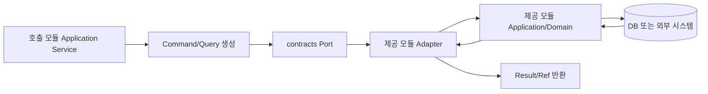
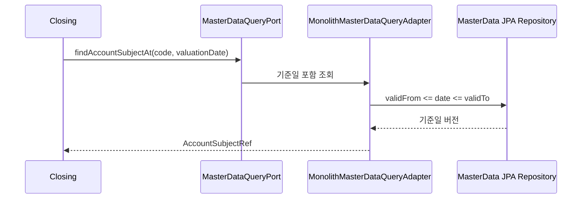

# Contracts 업무 및 데이터 흐름

## 1. 전체 호출 순서



`contracts`는 C 지점의 의미와 입력/출력 형식을 소유합니다. 트랜잭션, 승인, 계산, 저장은 제공
모듈이 소유합니다.

## 2. 전표 생성

1. 호출 서비스가 업무 엔티티의 승인/상태를 확인합니다.
2. `JournalLineCommand`를 생성하면서 차대 코드, 계정 코드, 금액 필수 형식을 검증합니다.
3. `JournalEntryCommand`가 일자와 비어 있지 않은 라인 목록을 확인하고 List를 불변 복사합니다.
4. `JournalPostingPort.createDraftEntry()`를 호출합니다.
5. journal-ledger Adapter가 계약을 도메인 전표로 변환합니다.
6. journal-ledger가 차변/대변 합계, 회계기간, 계정 사용 가능 여부를 검증합니다.
7. 저장 결과를 `JournalPostingResult`로 반환합니다.

계약 검증과 도메인 검증을 분리하는 이유는 “필드가 없음”과 “업무상 전기 불가”를 서로 다른
책임으로 처리하기 위해서입니다.

## 3. 기준정보 SCD2 조회



실제 master-data 어댑터는 계정과목, 거래처, 부서의 기준일 조회를 구현합니다. 호환용 default는
아직 일부 로컬/원격 어댑터를 위해 남아 있으며 제거 TODO가 있습니다.

## 4. 원문서 드릴다운

`SourceDocumentProvider`는 같은 Spring 프로세스의 제공 Bean을 capability로 찾습니다. 이는
Eureka 주소 검색이 아닙니다.

```text
Journal UI/API
  -> SourceDocumentService
  -> 로컬 ServiceDiscoveryRegistry
  -> SourceDocumentProvider.supports(sourceType)
  -> 제공 모듈 원문서 조회
  -> Map 응답
```

현재 Map 응답은 필드 버전과 민감정보 통제가 약하므로 sourceType별 DTO로 교체할 TODO가 있습니다.

## 5. 원격 MSA로 분리할 때

Port 메서드가 자동으로 네트워크 호출로 바뀌지 않습니다. 별도 어댑터에서 다음을 결정합니다.

- REST/Feign/Kafka 중 어떤 전송을 사용할지
- timeout/retry/circuit breaker
- 404, 업무 거절, 일시 장애의 오류 의미
- 계약 version과 하위 호환성
- 민감정보와 감사 추적

## 6. 기간 증빙과 전표 커밋을 연결하는 순서 (GH-762)

1. Closing이 Master의 기간 ID·일자 범위를 검증하고 Journal `checkpoint(scope)`를 호출합니다.
   Journal은 진행 중인 금액 변경의 실제 트랜잭션 종료를 기다린 뒤 영속 revision을 반환합니다.
2. 증빙 제공자는 **이 응답 이후** primary 원천에서 새 snapshot/조회 트랜잭션을 시작합니다.
   기존 snapshot이나 replica의 지연된 결과에 새 checkpoint를 붙이면 이 계약을 충족하지 않습니다.
3. Closing은 checkpoint를 대사 증빙 내용 및 digest와 함께 저장합니다. 증빙 제출만으로
   신규 전표가 차단되지는 않습니다.
4. 최종 마감은 영속 transition ID를 operation ID로 삼아 `fence(command)`를 호출합니다.
   Journal이 전표와 같은 DB 잠금을 획득한 뒤 revision을 원자적으로 비교합니다. 중간에 전표가
   커밋했다면 증빙을 거절하고, 일치하면 ACTIVE fence를 커밋한 후 응답합니다.
5. Closing은 정확히 일치하는 ACTIVE 응답을 확인한 뒤 Master 마감을 진행합니다. 이후 해당
   cutoff까지의 신규 금액 변경은 거절됩니다. 과거일 전표도 후속 잔액에 영향을 주므로 포함됩니다.
6. 취소·재오픈은 Closing의 복구 가능한 영속 단계에서 `release`합니다. 응답 유실은 같은 명령으로
   재시도하며, 옛 해제 요청은 새 operation의 fence를 해제할 수 없습니다.

로컬 메서드 호출과 원격 HTTP 호출은 같은 영속 구현을 사용합니다. HTTP timeout은 성공/실패를
단정할 수 없는 결과이며, 이를 근거로 마감을 확정하거나 게이트를 자동 해제하면 안 됩니다.
Journal 전체 admission row로 금액 변경이 직렬화되는 비용과 재시도·배포 조건은
[`journal-ledger` 동시성 문서](../../journal-ledger/docs/posting-concurrency.md)에 설명합니다.
