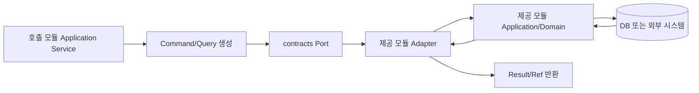
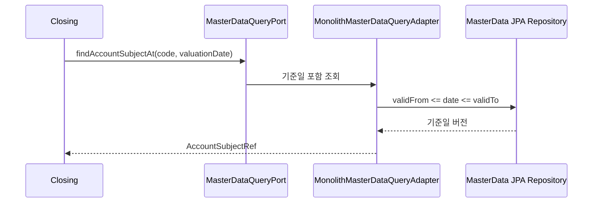

# Contracts 업무 및 데이터 흐름

## 1. 전체 호출 순서



`contracts`는 C 지점의 의미와 입력/출력 형식을 소유합니다. 트랜잭션, 승인, 계산, 저장은 제공
모듈이 소유합니다.

## 2. 전표 생성

1. 호출 서비스가 업무 엔티티의 승인/상태를 확인합니다.
2. `JournalLineCommand`를 생성하면서 차대 코드, 계정 코드, 금액 필수 형식을 검증합니다.
3. `JournalEntryCommand`가 일자와 비어 있지 않은 라인 목록을 확인하고 List를 불변 복사합니다.
4. `JournalPostingPort.createDraftEntry()`를 호출합니다.
5. journal-ledger Adapter가 계약을 도메인 전표로 변환합니다.
6. journal-ledger가 차변/대변 합계, 회계기간, 계정 사용 가능 여부를 검증합니다.
7. 저장 결과를 `JournalPostingResult`로 반환합니다.

계약 검증과 도메인 검증을 분리하는 이유는 “필드가 없음”과 “업무상 전기 불가”를 서로 다른
책임으로 처리하기 위해서입니다.

## 3. 기준정보 SCD2 조회



실제 master-data 어댑터는 계정과목, 거래처, 부서의 기준일 조회를 구현합니다. 호환용 default는
아직 일부 로컬/원격 어댑터를 위해 남아 있으며 제거 TODO가 있습니다.

## 4. 원문서 드릴다운

`SourceDocumentProvider`는 같은 Spring 프로세스의 제공 Bean을 capability로 찾습니다. 이는
Eureka 주소 검색이 아닙니다.

```text
Journal UI/API
  -> SourceDocumentService
  -> 로컬 ServiceDiscoveryRegistry
  -> SourceDocumentProvider.supports(sourceType)
  -> 제공 모듈 원문서 조회
  -> Map 응답
```

현재 Map 응답은 필드 버전과 민감정보 통제가 약하므로 sourceType별 DTO로 교체할 TODO가 있습니다.

## 5. 원격 MSA로 분리할 때

Port 메서드가 자동으로 네트워크 호출로 바뀌지 않습니다. 별도 어댑터에서 다음을 결정합니다.

- REST/Feign/Kafka 중 어떤 전송을 사용할지
- timeout/retry/circuit breaker
- 404, 업무 거절, 일시 장애의 오류 의미
- 계약 version과 하위 호환성
- 민감정보와 감사 추적

### 회계기간 마감·재개와 응답 유실

1. Closing이 로컬 전이 ID, 승인자, 기간 ID와 예상·목표 상태를 먼저 영속화합니다.
2. Master Data의 `prepareClosingTransition`은 동일 명령을 `PREPARED`로 영속화합니다.
   기간 행에 저장된 상태는 아직 바꾸지 않습니다. 다만 닫기 준비 중에는 전표 허용 판단에
   쓰이는 기간 조회와 공개 GET이 보수적으로 `CLOSED`를 돌려주어 새 전표를 막습니다.
   재개 준비 중에는 `OPEN`을 미리 돌려주지 않습니다.
3. Master Data가 예상 상태 조건 아래 `applyClosingTransition`으로 기간 행과 영수증을
   원자적으로 갱신합니다. 닫기는 `CLOSED`로 잠기고, 재개는 저장 상태가 `OPEN`이 되어도
   전표 허용용 조회는 계속 `CLOSED`입니다.
4. Closing이 승인·달력·감사 기록을 로컬 DB에 확정한 뒤
   `confirmClosingTransition`을 호출합니다. 확인 영수증이 `CONFIRMED`가 되어야 재개
   기간의 공개 조회가 `OPEN`을 돌려줍니다. 확인 응답이 유실되면 같은 ID로 재호출하거나
   영수증을 조회해 복구합니다.
5. timeout이나 응답 유실 시 `findTransitionReceipt`로 원격 상태를 조회하고 원본
   명령의 **모든** 필드와 대조합니다. `PREPARED`면 같은 ID로 적용을 이어가고,
   `APPLIED`면 로컬 확정과 원격 확인을 이어갑니다. `CONFIRMED`면 확인을 반복하지
   않고 로컬 결과를 대조합니다.
6. 닫기 준비 후 로컬 증거가 만료되어 더는 안전하게 적용할 수 없으면, 권한 있는
   복구 담당자가 원래 ID와 별도 취소 actor로 `cancelClosingTransition`을 호출합니다.
   Master Data는 기간/영수증을 잠그고 `PREPARED → CANCELLED`만 기록합니다. 이미
   `APPLIED`라면 취소를 거절하고, 응답 유실 뒤 같은 취소를 반복하면 저장된
   `CANCELLED` 영수증을 돌려줍니다. Closing은 영수증을 대조한 뒤 로컬 준비 상태를
   해제합니다. 닫기 준비 동안 보수적으로 `CLOSED`였던 기간 조회는 다시 저장 상태를
   따릅니다.

제공자는 동일 ID에 다른 기간·예상/목표 상태·actor를 받은 경우 충돌로 거절하고,
예상 상태가 틀리면 상태 변경을 거절해야 합니다. Closing은 이 충돌을 새로운 ID로
자동 우회하지 않습니다. 자세한 필드는 [schema.md](./schema.md)를 참조합니다.
