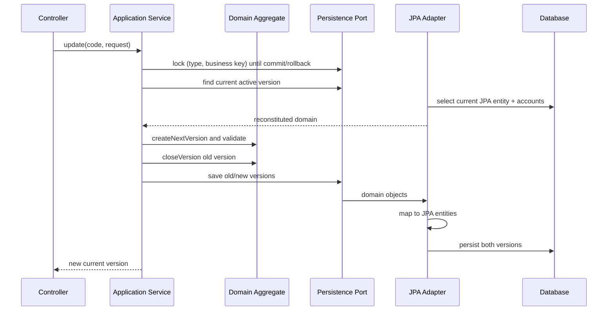
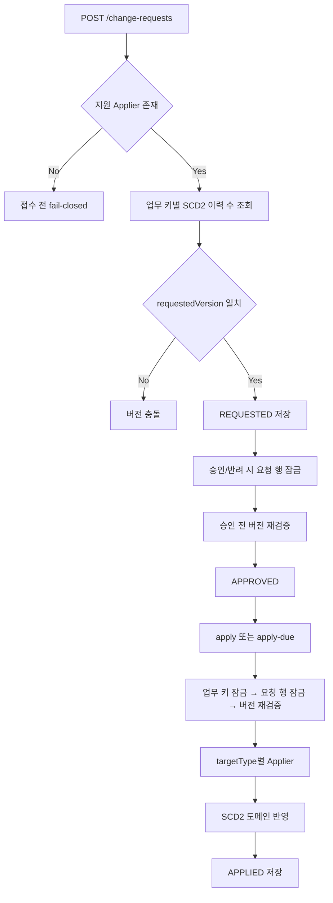
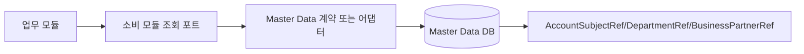
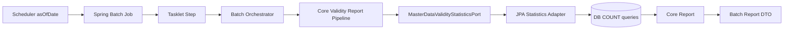
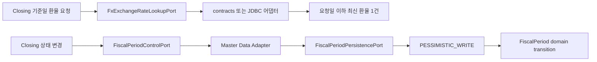

# master-data process flow

감사 주체 전파, 요청/결정 사유 분리, APPLIED 행 ID 연결과 이벤트 내보내기 절차는
[audit-evidence.md](audit-evidence.md)를 참조합니다.

## API 입구

### 수신 서비스 인증

`MasterDataIngressAuthenticationFilter`는 모든 비-`OPTIONS` 쓰기, `/api/master-data/**` 조회, `/api/internal/**` 요청이 Controller에 도달하기 전에 자격증명을 검증합니다. Servlet context path를 제외한 경로로 판단하며, MVC가 다르게 해석할 수 있는 matrix 세미콜론, 모든 percent 인코딩 경로, 점 경로 구간은 401로 차단합니다. 따라서 경로 ID에도 percent 인코딩을 사용할 수 없습니다. `OPTIONS` preflight는 업무 호출이 아니므로 통과합니다. 사용자는 `Authorization: Bearer <JWT>`가 필요합니다. 필터는 Auth와 공유한 `AUTH_JWT_SECRET`으로 서명, issuer(`AUTH_JWT_ISSUER`, 기본 `auth-service`), 발급·만료 시각, 설정한 `AUTH_JWT_AUDIENCE`(기본 `account-api`) audience, 사용자·역할·roleVersion claim을 확인합니다. Gateway가 전달한 `X-Auth-User`, `X-Auth-Roles`, `X-Auth-Role-Version`, `X-Auth-Department`, `X-User-ID`가 있으면 claim과 일치해야 하고, Controller에는 검증된 값만 전달합니다. 임의의 `X-Auth-*` 헤더는 거부합니다. 자격증명/설정 누락, 위조, 만료, claim 불일치는 401이며, 인증됐지만 역할이 허용되지 않으면 403입니다. 읽기 전용 `/api/basic/**`는 이 필터의 쓰기 정책 대상이 아닙니다.

Closing의 회계기간 상태 변경은 `X-Service-Assertion`에 별도 HS256 JWT를 보냅니다. 검증키는 `MASTER_DATA_CLOSING_ASSERTION_SECRET`이고 사용자 JWT 키와 달라야 합니다. assertion은 `iss=closing-service`, `sub=closing`, `aud=master-data-internal`, 현재 유효한 `iat`/`exp`(발급부터 만료까지 최대 5분), `actor`(1~42자의 안전한 ID), `actorRoles`(문자열 목록), `fiscalPeriodId`(양의 정수), `closingStatus`(`OPEN`/`CLOSED`/`PERMANENTLY_CLOSED`), `method=PUT`, `path=/api/internal/fiscal-periods/{id}/closing-status`를 포함해야 합니다. `path`는 servlet context path를 제외한 값이고 ID는 URL의 `{id}`, 상태는 JSON 본문의 `closingStatus`와 정확히 같아야 합니다. 형식이 올바르고 비어 있지 않은 ID/상태/메서드/경로가 서명된 값과 다르면 use case 호출 전에 401로 차단합니다. JSON 형식이 잘못되었거나 필수 `closingStatus`가 비어 있으면 MVC 역직렬화·검증 단계에서 400을 반환합니다. 위임 역할은 `ROLE_ADMIN`, `ROLE_SYSTEM_ADMIN`, `ROLE_ACCOUNTING_ADMIN` 중 하나여야 합니다. 선택적으로 전달한 `X-Service-Identity`는 정확히 `closing`이어야 합니다. 사용자 Bearer 또는 `X-Auth-*` 헤더는 내부 요청과 함께 사용할 수 없습니다. 서비스와 위임 actor는 각각 검증된 request attribute로 유지하고 기존 `fiscal_periods.audit_user VARCHAR(50)`에는 `closing:<actor>`를 저장합니다. 본문의 `auditUser`는 호환용 입력일 뿐 권한이나 감사 값으로 사용하지 않습니다. assertion의 5분 유효기간 안에는 같은 값을 다시 제출할 수 있으므로 재전송 방지가 필요하다면 `jti` 저장/중복 거부를 별도 통합 계약으로 추가해야 합니다.

현재 Closing HTTP 호출자는 이 assertion을 발급하지 않으므로 해당 호출은 401로 차단됩니다. Closing 클라이언트가 별도 키를 안전하게 주입받아 위 claim을 생성하도록 연동 변경이 필요합니다. 또한 Master Data는 서명된 `roleVersion`을 형식 검증하지만 현재 Auth 상태를 다시 조회하지 않습니다. Gateway 경로는 별도로 Auth의 현재 버전을 확인하며, Master Data에 직접 도달한 유효기간 내 토큰은 역할 변경 직후에도 과거 역할을 유지할 수 있습니다. 직접 서비스 접근 제한 또는 수신 서비스의 bounded Auth 조회를 별도 통합 게이트로 검토해야 합니다.

### HTTP 오류 계약

요청은 인증 필터 → Controller 입력 검증 → core 유즈케이스 순서로 처리됩니다. 필터가 거부한 요청은 Controller와 변경 유즈케이스에 도달하지 않습니다. `MasterDataIngressHttpTest`는 실제 필터 및 `MasterDataExceptionHandler`를 조립해 인증, 일반 입력, 변경 요청의 조회·상태·버전 충돌을 검증합니다. 멱등성·SCD2 기간 충돌은 기존 별도 테스트로 검증하며 전체 HTTP 조립 검증 범위에는 포함되지 않습니다.

| 상태 | 조건 | 응답 |
| --- | --- | --- |
| 400 | 필수 쿼리/헤더 누락, 잘못된 경로 ID·JSON·타입, DTO 또는 필드 규칙 검증 실패 | `ApiResponse.success=false`; 일반 입력 형식 오류는 `Bad request`, 필드 규칙 오류는 고정된 안전한 규칙 설명 |
| 401 | 사용자 토큰 또는 Closing assertion 누락·불일치·만료, 잘못된 서비스 identity | 빈 본문 |
| 403 | 검증된 사용자에게 승인 또는 직접 쓰기 역할이 없음 | 빈 본문 |
| 404 | 변경 요청 ID가 존재하지 않음 | `ApiResponse.success=false`, `Change request not found` |
| 409 | 변경 요청 버전·멱등성·적용 상태·SCD2 기간 충돌 | `ApiResponse.success=false`; 각각 `Master-data version conflict`, `Master-data idempotency conflict`, `Change request state conflict`, `Master-data validity period conflict.` |
| 500 | 위 사례로 분류되지 않는 서버 오류 | `ApiResponse.success=false`, `Internal server error` |

예를 들어 유효한 관리자 JWT로 `POST /api/master-data/change-requests/42/approve`를 호출했을 때 ID 42가 없으면 404입니다. 인증이 없으면 먼저 401로 끝나며 해당 ID를 조회하거나 변경하지 않습니다. 로컬에서 회귀를 확인하려면 저장소 루트에서 `./gradlew :master-data:api:test --tests com.ho.account.masterdata.api.web.MasterDataIngressHttpTest --offline --no-daemon --console=plain --max-workers=2`를 실행합니다. 이 테스트는 H2와 가짜 포트를 사용하므로 실제 PostgreSQL 및 서비스 간 호출의 증거는 아닙니다.

| 컨트롤러 | 경로 | 역할 |
| --- | --- | --- |
| `AccountSubjectController` | `/api/basic/account-subjects` | 계정과목 생성, 조회, SCD2 수정, 종료 |
| `DepartmentController` | `/api/basic/departments` | 부서 조회, 활성 부서 조회, 생성 |
| `BusinessPartnerController` | `/api/basic/businesspartners` | 거래처 생성, 조회, 검색, SCD2 수정, 종료 |
| `ProductController` | `/api/basic/products` | 상품 생성, 조회, 수정, 종료 |
| `MasterDataChangeRequestController` | `/api/master-data/change-requests` | 변경 요청, 승인, 반려, 반영 |

## 거래처 screening과 eligibility (Issue #923)

1. 활성 `CUSTOMER` 또는 `VENDOR`에 대해 인증된 기존 기준정보 관리자 역할(`ROLE_PARTNER_MANAGER` 등)의 사용자가 관할권, 식별자 유형·값, 증빙 참조와 선택적 만료일을 제출합니다. 서버는 JWT에서 제출자 ID와 역할을 얻습니다. 현재 허용하는 조합은 `KR`/`BUSINESS_REGISTRATION`/ASCII 숫자 10자리이며, 거래처 등록번호(숫자 10자리 또는 `123-45-67890` 형식)의 정규화 값과 같아야 합니다. 형식 검사는 실제 발급 사실을 확인하지 않습니다.
2. 서비스는 업무 코드를 잠그고 현재 screening을 `PENDING`으로 저장하며 제출 snapshot을 audit에 추가합니다. 이전 결정이 있어도 새 제출은 다시 심사해야 합니다. 같은 제출자의 동일한 `PENDING` 요청 재시도는 추가 저장·감사 없이 끝납니다.
3. 인증된 `SCREENING_REVIEWER`가 사유와 위험도를 포함하여 `APPROVED`, `REJECTED`, `REVIEW_REQUIRED` 중 하나로 결정합니다. 제출자와 동일한 ID는 거부됩니다. 결정 snapshot은 audit에 추가됩니다. 결정 후 같은 결정 재시도는 추가 기록이 없고, 다른 결정을 하려면 새 증빙 제출이 필요합니다. 저장과 audit 추가는 한 트랜잭션입니다.
4. 기준일 조회는 그날 유효하고 활성인 거래처 버전과, 그날 종료 전까지 기록된 **마지막 screening 감사 snapshot**을 함께 선택합니다. 결정은 결정 시각부터, 아직 결정되지 않은 제출은 제출 시각부터 반영됩니다. 마지막 상태의 결정·위험·증빙·식별번호가 기준일 거래처 등록번호와 일치해야 합니다. 하나라도 실패하면 `eligible=false`입니다. 뒤에 새 증빙이 제출되어 현재 행이 `PENDING`이어도 이전 날짜에는 당시 `APPROVED` 상태를 재현할 수 있습니다. 등록번호 변경 후 날짜에는 새 버전의 등록번호와 불일치한 이전 승인이 eligibility를 만들지 못합니다.

| 기준일의 마지막 screening 상태 | 위험도 | 유효한 증빙·식별번호와 활성 거래처 | eligibility |
| --- | --- | --- | --- |
| 없음 또는 `PENDING` | 모두 | 모두 | `false` |
| `REJECTED` 또는 `REVIEW_REQUIRED` | 모두 | 모두 | `false` |
| `APPROVED` | `HIGH` 또는 `CRITICAL` | 충족 | `false` |
| `APPROVED` | `LOW` 또는 `MEDIUM` | 만료일이 기준일 전, 증빙 참조 누락, 식별번호 누락·불일치, 미지원 정책 또는 비활성·미존재 거래처 | `false` |
| `APPROVED` | `LOW` 또는 `MEDIUM` | 모두 충족. 만료일 당일과 만료일 미지정은 허용 | `true` |

제출 시 식별번호·증빙 참조 누락, 이미 만료된 증빙, 미지원 관할권/유형, 거래처 등록번호 불일치는 400입니다. 없는 거래처는 404, 비활성 거래처·선행 제출 없는 결정·다른 재결정은 409입니다. 제출에 관리자 역할이 없거나 결정에 `SCREENING_REVIEWER` 역할이 없으면 403, 제출자 자기 심사는 400입니다. 인증된 `ROLE_USER`가 재제출해도 403으로 거부되어 기존 `APPROVED` 상태는 유지됩니다. 쓰기 요청의 무효·누락 JWT는 Controller 전 401입니다. `GET`은 `asOfDate` 생략 시 서버의 오늘 날짜를 사용하며, 없는 거래처나 기준일까지 screening 이력이 없는 거래처도 404 대신 `eligible=false`를 반환합니다. 날짜 단위 조회이므로 같은 날짜에 여러 상태가 기록되면 그날의 마지막 기록을 사용합니다. 기존 거래처 KYC/risk 필드는 screening 승인 또는 eligibility가 아닙니다.

## 신규 업무 키 생성


네 기준정보의 직접 `CREATE`는 저장 전에 업무 키 전체 이력의 존재 여부를 확인합니다.
계정과목·부서·상품은 각 코드의 저장소 `exists` 조회를 사용하고, 거래처도 날짜와 `useYn`을
제외한 코드 존재 조회를 사용합니다. 따라서 첫 행이 미래 예약이거나 이미 종료된 행이어도
같은 키의 두 번째 생성은 거부되고 첫 행은 그대로 남습니다. 기간의 양 끝은 포함되며,
같은 날에 닿는 구간뿐 아니라 하루 뒤의 인접 구간과 간격이 있는 구간도 재생성할 수 없습니다.
새로운 업무 키의 첫 행은 생성할 수 있습니다. 직접 또는 승인된 중복 `CREATE`는
`MasterDataVersionConflictException`으로 HTTP 409를 반환합니다. 현재 활성 버전이 있는
키의 SCD2 변경은 `UPDATE` 흐름을 사용합니다. 종료 이력만 있거나 미래 버전만 있는 키는
현재 `UPDATE`의 활성 버전 조건을 만족하지 않으므로 재활성화할 수 없습니다.

승인 요청의 `CREATE`는 기존처럼 접수·승인·반영 직전에 저장된 이력 수가 0인지 확인하며,
실제 반영에서도 같은 도메인 서비스의 생성 검사를 거칩니다. 조회 후 저장까지 동시에
진행되는 두 작성자의 경쟁은 이 순차 검사만으로 막을 수 없고, 별도의 F07/#753 제약 작업과
실제 PostgreSQL 검증이 필요합니다.

## 기준정보 SCD2 수정 흐름



기존 값을 직접 덮어쓰지 않고 이전 버전을 종료한 뒤 새 버전을 만듭니다. 그래서 과거 전표와 보고서는 과거 기준정보를 다시 조회할 수 있습니다.
신규 `validFrom/validTo` 기간이 뒤집히지 않았는지 먼저 검증하므로, 잘못된 신규 기간 때문에
기존 활성 행만 먼저 종료되는 순서 오류를 막습니다. 계정과목과 부서는 상위 항목 조회와 신규
버전 조립까지 끝낸 다음 현재 행을 종료하므로 잘못된 `parentCode`도 기존 행을 건드리지 않습니다.

계정과목은 현행 aggregate의 업무 필드를 먼저 새 행으로 복사하고, 요청에 명시된 값만 적용합니다.
따라서 이름만 바꿔도 `NON_OPERATING_INCOME`/`NON_OPERATING_EXPENSES`와 규제 매핑 코드가
과거·새 버전에 각각 유지됩니다. 생략한 `unsettled`/`fixedAsset`는 유지하고 명시한 `false`는
변경합니다. 빈 `parentCode`/`reportLine`은 각각 연결/보고 라인을 해제합니다.
새 행은 기존 ID·생성/수정 시각·감사 사용자를 재사용하지 않습니다.

분류 유형과 규제 매핑은 승인 요청의 계정과목 `payloadJson`에서만 바꿀 수 있습니다.
예를 들어 `{"name":"기타수익","category":"REVENUE","accountType":"NON_OPERATING_INCOME","regulatoryMappingCode":"REG-NEW"}`는
승인·시행 후 새 버전만 변경합니다. 매핑만 해제할 때는 코드 값 대신
`{"name":"기타수익","clearRegulatoryMappingCode":true}`를 사용합니다.
코드 값과 해제 플래그의 동시 지정, category와 accountType의 불일치, 공백/100자 초과 매핑 코드는
접수·승인 전에 검증하고 기존 행을 종료하기 전에 다시 확인합니다. CREATE의 매핑 해제 플래그도
의미가 없으므로 접수 전에 거부합니다. `accountType:null`이나 `regulatoryMappingCode:null`을
명시하면 생략과 혼동되지 않도록 거부합니다. 직접 계정과목 PUT의 분류·매핑 필드는 HTTP 400입니다.
승인 경로는 요청자·승인자·사유·원문 payload와 `appliedAt`을 변경 요청 이력에 남깁니다.

거래처에서는 `closeVersion()`과 `terminate()`를 구분합니다. 수정은 이전 SCD2 버전의 기간만
닫고 `useYn`을 유지하며, 비활성화도 종료일만 닫아 과거 조회를 위해 `useYn`을 유지합니다. 종료일 다음 날부터는 기간 조건으로 제외됩니다. 저장소 조회는
`BusinessPartnerJpaEntity`와 계좌를 한 aggregate로 읽은 뒤 포트 밖으로 순수 도메인만 반환합니다.
다음 버전의 계좌는 업무 값만 복제하고 자식 ID를 비워 새 FK 행으로 저장하므로 과거 계좌가
새 부모로 이동하지 않습니다.
현재/기준일 단건 조회에서 기간이 겹친 행이 여러 개면 `Optional`로 임의 선택하지 않고 실패해
데이터 이상을 숨기지 않습니다.

## 변경 요청 승인 흐름



`MasterDataChangeApplierRegistry`는 한 targetType을 정확히 한 typed applier에 연결합니다. 담당 전략이 없으면 요청이 커밋되기 전에 실패하고 원자적 예약 행도 롤백됩니다. 같은 유형을 두 전략이 담당하면 애플리케이션 시작 시 실패합니다. 현재 `ACCOUNT_SUBJECT`, `BUSINESS_PARTNER`, `DEPARTMENT`, `PRODUCT`를 지원합니다.

`core` 변경 요청 유즈케이스에 Governance 승인 ID를 `sourceReference`로 전달하면 같은 승인 재시도는 기존 변경 요청을 재사용합니다.
현재 HTTP 생성 DTO에는 이 필드가 없어 `/api/master-data/change-requests` POST의 재시도 키로 사용할 수 없습니다.
PostgreSQL에서는 최초 접수의 `INSERT ... ON CONFLICT DO NOTHING` 후 새 문장에서 기존 행을
읽으므로 동시 요청도 같은 ID와 저장된 결과를 받습니다. 기존 행이면 대상·유형·시행일·버전·요청자·사유·
원문 payload를 비교해 불일치 시 충돌 예외를 반환합니다. 해당 예외는 API advice에서 409로 매핑되지만 현재 POST 입력으로는 이 경로를 호출할 수 없습니다. 새 행만 업무 키를 잠그고 payload/버전을 검증하며,
실패하면 예약 행도 같은 트랜잭션에서 롤백합니다. 이미 `APPLIED`인 요청 ID를 다시 반영하면 잠금 후
기존 결과를 반환해 SCD2 버전과 `appliedAt`을 그대로 둡니다. 이는 성공 응답 유실 후 재시도할 때의 계보입니다.
로컬 H2는 V8 잠금 테이블에 source reference별 별도 행을 두고 트랜잭션 종료까지 잠근 뒤 조회·저장합니다.
새 반려 요청은 원래 요청 사유와 반려 사유를 별도 보존하므로 같은 명령을 다시 보낼 수 있습니다.
별도 열이 없던 시기에 이미 반려된 행은 원래 사유를 복원할 수 없어 재시도를 409로 거부합니다.
`requestedVersion`은 임의 숫자가 아니라 업무 키별 SCD2 목표 순번입니다.

### 변경 요청 HTTP 응답과 원문 접근

`POST /api/master-data/change-requests`, `GET /pending`, 승인·반려·단건 반영 및
`POST /apply-due`는 동일한 요약 DTO를 반환합니다. 응답에는 `id`, `targetType`,
`changeType`, `status`, `effectiveDate`, `requestedVersion`, `requestedAt`, `approvedAt`,
`appliedAt`만 포함합니다. `payloadJson`과 자유 입력 문자열(`targetKey`, 요청자·승인자,
사유, `sourceReference`)은 응답에 넣지 않습니다. 예를 들어 거래처 등록번호가
`payloadJson` 안에 있거나 사유에 복사되어도 JSON 문자열 안으로 다시 나오지 않습니다.
클라이언트는 응답 `id`와 상태로 결과를 확인하고, 승인할 때 요청 ID를 사용합니다.

원문 조회를 시도하는 `GET /api/master-data/change-requests/{requestId}/raw-detail`은
현재 모든 사용자 역할에 HTTP 403으로 명시적으로 거부됩니다. 서비스의 JWT 검증을
통과하지 못한 요청은 Controller 전에 401입니다. 정형 상세 경로의 인증 실패는
`actor=unverified`, 인증된 사용자의 거부는 검증된 사용자와 숫자 요청 ID만 담은
`master_data_raw_detail_denied` 보안 감사 이벤트로 남깁니다. 원문이나 등록번호는
기록하지 않습니다. 운영 감사 수집기의 보존·조회 정책은 별도 운영 게이트입니다.
원문 상세가 업무상 필요해지면 단건 조회 포트, 별도 세분 권한과 지속 감사 저장을 갖춘
계약을 별도 검토해야 합니다. 이 응답 변환은 저장된 원문, 승인·반영 명령,
`sourceReference`의 멱등 비교를 바꾸지 않습니다.

현재 프런트 거래처 승인 화면은 `payloadJson`을 필수로 파싱해 승인 버튼을 활성화하므로
이 요약 응답만 배포하면 화면에서 대기 요청을 승인할 수 없습니다. 프런트와 별도 상세
계약을 함께 갱신하거나, 화면 차단을 명시적으로 수용하기 전에는 호환 배포로 간주하지 않습니다.

| 변경 유형 | 요청 버전 | 이유 |
| --- | --- | --- |
| `CREATE` | `1` | 이력이 없는 업무 키의 첫 행을 생성합니다. |
| `UPDATE` | 현재 저장된 이력 수 + 1 | 이전 행을 종료하고 신규 SCD2 행을 추가합니다. |
| `DEACTIVATE` | 현재 저장된 이력 수 | 신규 행 없이 현재 행의 종료일만 바꿉니다. |

요청을 저장한 뒤 승인이나 시행일까지 다른 변경이 먼저 반영될 수 있으므로 요청, 승인, 반영 직전에 같은 정책을 반복 확인합니다. 승인/반영은 업무 키 잠금을 얻은 뒤 `PESSIMISTIC_WRITE`로 요청 행을 직렬화하고, JPA `lockVersion`으로 예상하지 못한 동시 갱신도 감지합니다.

CREATE/UPDATE payload의 업무 코드는 승인 대상 `targetKey`와 같아야 합니다. DEACTIVATE는 변경 필드가 없으므로 payload를 요구하지 않고 승인된 `effectiveDate`를 종료일로 사용합니다. 실제 typed applier와 도메인 서비스가 성공한 뒤에만 `APPLIED`가 됩니다.

예약 반영인 `/apply-due`는 `findAll()` 후 메모리 필터를 하지 않습니다. `status=APPROVED`, `effectiveDate <= today` 조건으로 `effectiveDate`, `requestedAt`, `id` 순 최대 500건을 조회합니다. 각 후보는 별도 `REQUIRES_NEW` 트랜잭션에서 업무 키 → 요청 행 순으로 잠근 뒤 상태와 버전을 다시 확인합니다. 성공한 SCD2 변경과 `APPLIED`는 함께 커밋됩니다. 확정적인 버전 충돌·입력 오류는 해당 반영만 롤백하고 별도 트랜잭션에 `FAILED_CONFLICT` 또는 `FAILED_INVALID`와 안전한 실패 코드·시각을 저장합니다. 원래 요청 사유와 승인 감사 정보는 그대로 둡니다. HTTP 응답에는 실제 처리된 성공·실패 건이 선택 순서로 포함되며, 다른 작업자가 먼저 처리한 건은 건너뜁니다.

다시 실행하면 `APPROVED`만 선택하므로 `APPLIED`와 `FAILED_*`는 중복 반영되지 않습니다. 격리된 실패 요청은 자동 재시도하지 않으며 담당자가 원인을 확인하고 새 승인 요청을 제출해야 합니다. SQL 연결·잠금 등 인프라 오류와 예상 밖 오류는 해당 요청을 `APPROVED`로 남기고 호출을 실패시켜, 장애 복구 후 다시 시도할 수 있게 합니다. 이때 이미 커밋된 앞 요청은 유지되며 뒤 요청은 다음 실행에서 처리됩니다. 두 작업자가 같은 후보를 읽을 수 있지만 잠금 후 상태를 재확인해 한 번만 적용합니다. 합성 PostgreSQL 두 작업자 테스트는 중복 반영을 차단하지만, 아직 `SKIP LOCKED`가 없어 같은 앞쪽 요청을 기다릴 수 있으며 운영 규모 처리량은 별도 검증이 필요합니다.

## 타 모듈 조회 흐름



목표 구조에서 업무 모듈은 `master-data` JPA 엔티티를 직접 참조하지 않고 코드나 ID만 저장하며,
상세 이름/속성은 소비 모듈 소유 포트 뒤의 contracts 포트 또는 API로 조회합니다. Loan은
거래처 ID·통화 코드를 저장하고 `LoanReferenceDataPort`를 사용합니다. 모놀리스 어댑터는
Master Data 영속성 포트를 사용하지만 dev 원격 어댑터의 숫자 거래처 ID·기준일 통화 검증은
제공 API가 없어 실패합니다. Closing 환율 조회는 `FxExchangeRateLookupPort` 뒤의 contracts
어댑터(모놀리스) 또는 JDBC 어댑터(dev)를 사용합니다.

거래처 현재 조회는 `useYn=true`와 오늘의 유효기간을 함께 보지만, 과거 기준일 조회는 종료된
SCD2 행도 유효기간으로 찾습니다. 따라서 거래처가 나중에 변경·종료돼도 과거 전표의 당시
거래처명을 복원할 수 있습니다. 단건 조회는 `Optional` 반환으로 겹치는 기간이 두 행이면
한 행을 임의 선택하지 않고 예외로 중단합니다.

### 거래처 벌크 참조 조회의 중복 오류 (GH-911)

`MonolithMasterDataQueryAdapter`의 `findAllByPartnerCodes(codes)` 구현은 현재 활성 거래처를
한 번의 DB 조회로 읽고 코드별 `BusinessPartnerRef` Map을 반환합니다. 같은 입력 코드가
여러 번 있어도 저장된 활성 버전이 한 건이면 정상적으로 한 항목을 반환하며, 없는 코드는
Map에서 빠집니다. `null` 또는 빈
입력은 빈 Map을 반환합니다.

이 구현의 조회 결과에 **한 코드의 활성 버전이 둘 이상** 있으면
`DuplicateBusinessPartnerReferenceException`을 던지고 Map 자체를 반환하지 않습니다.
시작일이 같거나 달라도 같은 기준일에 겹치면 동일하게 실패합니다. 이 예외는
`IllegalStateException`이므로 소비자는 이를 누락 코드나 성공한 일부 Map으로 바꾸지 말고
검증을 중단해야 합니다. 현재 Tax의 HTTP 어댑터는 contracts 기본 벌크 메서드를 상속하여
코드별 단건 HTTP 조회를 반복합니다. 그 경로는 이 전용 예외를 직접 받지 않지만, 단건 조회의
비-404 HTTP 오류는 예외로 전파되고 Tax 검증 서비스도 조회 오류를 잡아 성공 건수를
반환하지 않습니다. H2 회귀는 Monolith 경로의 손상된 합성 행 조회·어댑터 동작을 검증하지만
PostgreSQL V9 exclusion과 운영 데이터 정합성의 증거는 아닙니다.

JDK 17과 캐시된 Gradle 의존성이 있는 저장소 루트에서 다음 명령으로 확인할 수 있습니다.

```bash
./gradlew :master-data:core:test --tests 'com.ho.account.masterdata.core.infrastructure.adapter.MonolithMasterDataQueryAdapterTest' --offline --no-daemon --console=plain --max-workers=2
./gradlew :master-data:core:test :master-data:api:test :master-data:batch:test --offline --no-daemon --console=plain --max-workers=2
```

첫 명령은 중복 시작일 두 경우와 반복·서로 다른·빈 입력을, 두 번째는 core/API/Batch의
기존 계약 회귀를 확인합니다. 성공하면 두 명령 모두 `BUILD SUCCESSFUL`로 끝납니다.

SCD2 교체용 `closeVersion`과 업무 종료용 `terminate`는 과거 조회를 위해 `useYn`을
보존합니다. 현재 활성 조회의 기간·`useYn` 조건은 KYC·위험 등급 심사 적격성을 검사하지
않습니다. 서비스의 중복 종료 요청은 같은 종료일을 다시 적용할 때 409로 거부합니다.

### 같은 업무 키의 쓰기 순서

1. 직접 CREATE/UPDATE/DEACTIVATE와 승인 반영은 동일한 `MasterDataBusinessKeyLockPort`를
   사용합니다. 키가 없으면 잠금 행을 생성하며, 트랜잭션 종료까지 잠금을 유지합니다.
2. ID 기반 거래처/상품 수정은 먼저 스칼라 업무 키만 읽고 잠근 뒤 도메인을 읽습니다.
   네 유형 모두 수정용 조회에서 선택한 엔티티를 DB에서 refresh합니다. 외부 트랜잭션이
   잠금 대기 전에 읽어 둔 JPA 캐시로 변경을 계산하지 않기 위한 순서입니다. 승인 applier의
   현재 기간 확인도 수정용 조회를 사용하며 전체 컨텍스트를 clear하지 않습니다.
3. 승인/반영은 업무 키 → 요청 행 순서로 잠그고 요청을 새로 읽습니다. `requestedVersion`
   검사는 잠금 후 수행하며, 서로 다른 요청 ID의 패자는409로 실패하고 `APPROVED`/`appliedAt=null`을 유지합니다.
   이미 반영된 같은 ID의 재시도는 기존 `APPLIED` 결과를 반환하며 다시 반영하지 않습니다.
4. 이전 버전의 종료일을 DB에 flush한 뒤 새 버전을 넣습니다. PostgreSQL의 즉시 exclusion
   검사가 정상적인 기간 분할의 중간 상태를 겹침으로 오인하지 않도록 합니다.
   상품 UPDATE는 새 가격의 부호·정밀도·범위를 core에서 먼저 확인하고 새 버전을 준비한 뒤
   이 종료/저장 단계를 시작합니다. 승인 요청은 접수·승인·반영 때 같은 가격 정책을
   검사하며, 생략한 UPDATE 가격은 잠금 후 읽은 현재 버전에서 이어받습니다.
5. `/apply-due`는 최대 500개 후보를 고르되 한 요청의 업무 키와 요청 행만 그 요청의
   트랜잭션 종료까지 잠급니다. 따라서 뒤 요청의 실패가 앞 성공을 되돌리지 않습니다.

`requestedVersion`은 이력 행 수이지 모든 변경을 세는 revision이 아닙니다. 종료는 행 수를
늘리지 않으므로, 이전 종료 이후에도 더 이른 종료일로 줄이는 유효한 순차 보정은 허용됩니다.
동일 종료일 재적용, 이미 종료된 대상의 승인 반영, 오래된 생성/수정 버전은409입니다.
다른 키의 단건 작업은 이 잠금과 독립적으로 진행합니다.

## 일일 유효성 보고 흐름



`master-data:batch`의 Job/Step은 실행 흐름과 파라미터 변환만 소유하고 core pipeline은 batch DTO를 참조하지 않습니다. 기준일 `asOfDate`가 없으면 현재 날짜로 조용히 대체하지 않고 실패합니다. 네 기준정보의 전체 행을 Java 메모리에 올리지 않고 DB 집계 쿼리로 활성 건수만 가져옵니다. 실행 요약은 primitive 값으로 Step execution context에 기록해 Java record 직렬화에 재시작 메타데이터를 결합하지 않습니다.

API 활성 계정과목/상품 목록도 같은 원칙으로 `validFrom <= 기준일 <= validTo`를 DB에서 필터링합니다.
거래처 이름 검색은 `useYn=true`, 유효기간, 이름 조건을 한 쿼리에서 확인합니다.

## 환율과 회계기간 흐름



환율 쿼리는 정렬만 한 다건 결과를 `Optional`로 받지 않고 Spring Data의 `findFirst...OrderBy...Desc`
계약으로 DB에서 한 건만 선택합니다. 회계기간은 열린 상태에서 바로 영구 마감할 수 없고,
영구 마감 후 재오픈할 수 없으며, 상태 변경자는 감사 사용자로 남습니다.

## 현재 고도화 후보

- `CURRENCY`, `EXCHANGE_RATE`, `FISCAL_PERIOD`는 도메인 서비스, 영속성 포트, 버전 조회, typed applier를 함께 구현하기 전까지 요청 접수부터 fail-closed 됩니다.
- 원자적 접수 경쟁은 PostgreSQL `READ COMMITTED`와 source reference unique index에서 검증합니다. H2 테스트는 PostgreSQL의 충돌 대기나 rollback-only 동작을 증명하지 않습니다.
- Loan dev 원격 참조 검증은 Master Data API에 숫자 거래처 ID·기준일 통화 조회가 없어 실패합니다. 두 모듈의 조회 계약을 맞춘 뒤 원격 어댑터를 완성해야 합니다.
- `TaxProfile`은 엔티티만 있고 repository/use case/applier/소비 계약이 없습니다. Tax와 소유권을 정해 전체 SCD2 흐름을 구현하거나 중복 모델을 이관·제거해야 합니다.
- 전체 이력/검색/pending API는 아직 무제한 List 계약입니다. 안정 정렬, 최대 page size와 DB limit가 있는 pagination을 포트부터 HTTP까지 연결해야 합니다.
- `/apply-due`의 요청별 트랜잭션과 실패 상태 기록은 구현되었습니다. 운영 규모의 병렬 처리를 위해 `SKIP LOCKED` 파티셔닝과 별도 실행 이력/관제 포트는 후속 과제입니다.
- 계정과목/부서/거래처/상품의 직접 쓰기 API는 `MasterDataDirectWritePolicy`에 의해 관리자 보정 전용(`ROLE_ADMIN`, `ROLE_SYSTEM_ADMIN` 등)으로 인가 제한이 적용되었습니다. 변경 요청(`/api/master-data/change-requests`)의 접수·승인·반려·반영과 pending 조회도 `PARTNER_MANAGER`, `MASTER_MANAGER`, `ACCOUNTING_ADMIN`, `SYSTEM_ADMIN`, `ADMIN` 역할 중 하나가 있어야 합니다.
- `master-data:batch`는 독립 Job/Step 실행 모듈이지만 현재 결과를 execution context에만 남깁니다. 운영 장기 보관과 관제를 위해 실행 이력 출력 포트와 메트릭/알림 어댑터를 추가해야 합니다.
