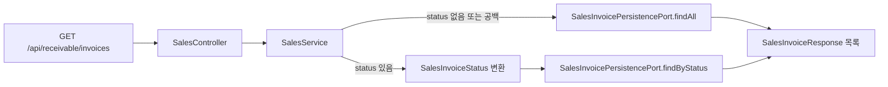
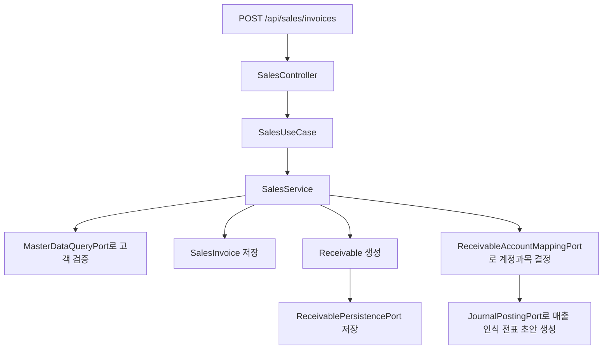

# receivable process flow

## API 입구

`receivable:api`를 실행하면 아래 엔드포인트를 사용할 수 있다. `SalesController`는 기존 `/api/sales`와 프런트엔드 호환 경로인 `/api/receivable`을 같은 기능의 별칭으로 제공한다.

| 컨트롤러 | 메서드 | 경로 | 역할 |
| --- | --- | --- | --- |
| `SalesController` | `POST` | `/api/sales/invoices`, `/api/receivable/invoices` | 매출 인보이스를 등록하고 채권 및 매출 인식 전표를 만든다. |
| `SalesController` | `GET` | `/api/sales/invoices`, `/api/receivable/invoices` | 전체 인보이스 또는 `status`와 일치하는 인보이스를 조회한다. |
| `SalesController` | `GET` | `/api/sales/invoices/{id}`, `/api/receivable/invoices/{id}` | ID로 인보이스 한 건을 조회한다. |
| `SalesController` | `POST` | `/api/sales/receivables/update-status/{asOfDate}`, `/api/receivable/receivables/update-status/{asOfDate}` | 기준일 이전 미수 채권을 연체 상태로 갱신한다. |
| `CollectionController` | `POST` | `/api/collections` | 고객 입금을 수납으로 기록하고 수납 인식 전표를 만든다. |
| `CollectionController` | `POST` | `/api/collections/{collectionId}/auto-match` | 특정 수납을 열린 채권 후보와 자동 매칭한다. |
| `CollectionController` | `GET` | `/api/collections/unmatched` | 자동 매칭되지 않은 수납 목록을 조회한다. |
| `CollectionController` | `POST` | `/api/collections/manual-match` | 사용자가 지정한 채권에 수동으로 수납액을 배분한다. |

`manual-match` 본문에는 `collectionId`, `receivableId`, `matchingAmount`와 함께 클라이언트가 정한 `operationId`(1~90자)를 넣는다. 금액은 `NUMERIC(19,2)`에 반올림 없이 저장 가능한 값이어야 한다. 응답을 받지 못했을 때는 **같은** ID와 내용으로 재시도한다. 같은 수납에서 ID를 재사용하면서 채권 또는 금액을 바꾸면 HTTP 409로 거부된다. 원장의 같은 작업 키 충돌도 HTTP 409로 전달된다.

```json
{"collectionId": 20, "receivableId": 30, "matchingAmount": 100.00, "operationId": "bank-match-2026-001"}
```

위 요청이 성공하면 HTTP 200이며, 같은 본문을 다시 보내도 배분·전표를 추가하지 않는다. 같은 수납과 채권에 다음 100원을 따로 배분하려면 다른 `operationId`가 필요하다.

## 매출 인보이스 조회 흐름



- `status`는 선택값이다. 생략하거나 공백이면 전체를 반환한다.
- 값이 있으면 앞뒤 공백과 대소문자를 정규화한 뒤 `ISSUED`, `PAID`, `PARTIAL_PAID`, `OVERDUE`, `CANCELLED` 중 하나로 조회한다.
- 지원하지 않는 상태는 HTTP `400 Bad Request`, 존재하지 않는 `{id}`는 `404 Not Found`를 반환한다.
- 조회 서비스는 read-only 트랜잭션이며 도메인 모델을 변경하지 않는다. 같은 요청을 다시 실행해도 조회 결과 외의 상태 변화는 없다.

초보자 예시: `GET /api/receivable/invoices?status=paid`는 수금 완료 인보이스 목록을 반환한다. `GET /api/receivable/invoices/10`은 10번 인보이스 한 건을 반환하며, 10번이 없으면 404가 된다. 기존 클라이언트는 동일하게 `/api/sales` 경로를 사용할 수 있다.

## 매출 인보이스 등록 흐름



핵심 정합성 포인트:

- 고객 코드는 `master-data`에서 검증한다.
- 인보이스 총액은 공급가액과 세액의 합으로 만들어진다.
- 채권은 인보이스 총액과 만기일을 기준으로 열린 상태로 생성된다.
- 전표 생성에 필요한 매출채권, 매출, 매출부가세 계정이 존재해야 한다.
- 매출 인식은 `(SALES_INVOICE_REF, invoiceNo, SALES_RECOGNITION)`, 수납 인식은 `(COLLECTION_REF, referenceNo, COLLECTION_RECOGNITION)`을 사용한다. DB에서 새로 발급되는 ID는 원격 생성 identity에 포함하지 않는다.

## 수납과 매칭 흐름

```mermaid
flowchart TD
    A[POST /api/collections] --> B[CollectionService.receivePayment]
    B --> C[고객 검증]
    C --> D[Collection 저장]
    D --> E[수납 인식 전표 초안 생성]

    F[POST /api/collections/{id}/auto-match] --> G[Collection 조회]
    G --> H[고객별 열린 Receivable 조회]
    H --> I[CollectionMatchingPolicyPort.selectMatch]
    I -->|단일 후보| J[processMatch]
    I -->|없음 또는 중복 후보| K[Collection UNMATCHED]
    J --> L[Receivable.applyCollection]
    J --> M[Collection.applyAllocation]
    L --> N[CollectionAllocation 저장]
    M --> N
    N --> O[SalesInvoice 상태 갱신]
    O --> P[AR Clearing 전표 초안 생성]
```

자동 매칭은 안전을 우선한다. 후보가 여러 개면 임의로 하나를 고르지 않고 미매칭 상태로 남긴다. 잘못된 채권을 닫는 것보다 사람이 확인하도록 남기는 편이 고객 잔액과 감사 추적에 안전하다.

매칭은 수납 행과 대상 채권 행을 잠근 상태에서 해당 작업 ID의 기존 배분을 확인하고, 새 배분에는 `(collection_id, operation_id)` 유일 제약을 적용한다. 자동 후보 조회 뒤에는 잠근 채권의 최신 잔액을 다시 읽어 다른 수납의 동시 배분이 먼저 반영되었는지 확인한다. 수동 작업 ID는 `MANUAL:<operationId>`, 자동 작업 ID는 수납 범위의 `AUTO_REMAINDER_V1`이다. 자동 매칭은 해당 수납의 남은 금액 전체를 한 번에 배분해 `MATCHED`로 종료하며, 배분 취소/추가 자동 사건 경로는 없다. 후보 채권 ID를 작업 키에 넣으면 원장 성공 뒤 소스 롤백과 후보 변경이 새 전표를 만들 수 있으므로, 대상과 금액은 fingerprint 내용에만 포함한다. 같은 수납의 재시도가 다른 후보를 고르면 409로 중단하고 기존 원격 결과와 대사한다. 향후 배분 취소 후 새 자동 사건을 지원하려면 별도 불변 incoming operationId 계약이 필요하다. 같은 수납/채권에 별도 부분 배분을 하려면 수동 요청마다 새로운 ID를 사용한다. 두 ID는 원장 전표에도 그대로 전달하여 원장 측의 원자적 중복 판단에 사용한다.

## 수납·채권 고객 일치 검증

수동 매칭은 `POST /api/collections/manual-match`에 `collectionId`, `receivableId`, `matchingAmount`, `operationId`를 전달한다. 예를 들어 같은 고객의 미배분 수납 100과 미수채권 500에 `{"collectionId":20,"receivableId":30,"matchingAmount":100.00,"operationId":"bank-match-2026-001"}`을 보내면 수납은 `MATCHED`(잔액 0), 채권은 `PARTIAL_PAID`(잔액 400)가 된다. 자동 매칭도 고객별 열린 채권을 조회한 뒤 같은 `processMatch`를 사용하며, 배분 금액이 일부이면 각 객체의 남은 잔액에 맞춰 상태가 바뀐다.

`processMatch`는 두 고객 코드가 같은지 먼저 확인한다. 다른 고객의 수납과 채권이 들어오면 `IllegalArgumentException`으로 거부하고 양쪽 잔액·상태, 배분 이력, 인보이스 상태, 반제 전표를 변경하지 않는다. 이 확인을 공통 진입점에서 수행하므로 자동 매칭 후보 포트가 다른 고객의 채권을 반환해도 같은 규칙이 적용된다. 정상 매칭의 `AR_CLEARING` 전표 두 라인에는 수납 고객 코드가 유지된다. 이미 기록된 잘못된 배분을 복구하거나 DB에서 고객 일치를 강제하는 변경은 이 흐름에 포함되지 않는다.

수동 매칭에서 이미 사용된 `operationId`는 먼저 원래 채권과 금액을 대조한다. 다른 채권이 다른 고객 소속이더라도 ID 재사용은 HTTP 409 충돌로 응답한다. 새 작업 ID는 잠근 채권의 고객 코드를 검사한 뒤에만 잔액과 배분 이력을 변경한다.

전표 설명에는 조회 시 바뀔 수 있는 고객 이름 대신 수납에 저장된 고객 코드를 사용한다. 새 배분은 기존처럼 master-data에서 고객 존재 여부를 확인한다. 이미 저장된 같은 작업의 재시도는 이 조회 없이 기존 배분을 반환한다. 원장만 성공하고 receivable 트랜잭션이 롤백된 뒤 master-data가 일시적으로 응답하지 않으면, 그 재시도는 고객 검증 단계에서 실패할 수 있으며 나중에 같은 작업 ID로 다시 시도해야 한다.

전제: JDK 17과 저장소 루트의 Gradle wrapper. 회귀 검증은 `./gradlew :receivable:core:test --tests com.ho.account.receivable.application.service.CollectionServiceTest --offline --no-daemon --console=plain --max-workers=2`로 실행한다. 기대 결과는 교차 고객 거부와 저장·전표 포트 미호출, 같은 고객의 수동·자동 부분 매칭 성공이다. 실제 PostgreSQL 및 원격 GL 연동은 별도 검증이 필요하다.

## 자동 매칭 정책

`ReferenceFirstCollectionMatchingPolicy`는 아래 순서로 후보를 좁힌다.

1. 채권 잔액이 0보다 크고, 수납 미배분액보다 크거나 같은 후보만 남긴다.
2. `Collection.referenceNo`가 있으면 인보이스 번호와 대소문자 무시 비교를 먼저 한다.
3. 참조번호 단일 후보가 없으면 만기일과 수납일 차이가 7일 이내인 단일 후보를 찾는다.
4. 그래도 없으면 채권 잔액과 수납 미배분액이 정확히 같은 단일 후보를 찾는다.
5. 모든 단계에서 후보가 2건 이상이면 `Optional.empty()`를 반환해 수동 확인으로 남긴다.

## 전표 유형과 차대변

| 업무 | 전표 유형 | 차변 | 대변 |
| --- | --- | --- | --- |
| 매출 인식 | `SALES_RECOGNITION` | 매출채권 | 매출, 매출부가세 |
| 수납 인식 | `COLLECTION_RECOGNITION` | 현금/예금 | AR Clearing |
| 채권 반제 | `AR_CLEARING` | AR Clearing | 매출채권 |

## 부분 매칭 흐름

부분 매칭은 한 번의 입금이 여러 청구서를 갚거나, 한 청구서를 여러 번 나누어 갚을 때 필요하다.

- `Collection.matchedAmount`: 지금까지 배분된 누적 수납액.
- `Collection.getUnallocatedAmount()`: 아직 어떤 채권에도 배분되지 않은 입금 잔액.
- `Receivable.outstandingAmount`: 아직 회수되지 않은 채권 잔액.
- `CollectionAllocation`: 이번 매칭 금액과 매칭 직후 양쪽 잔액을 남기는 감사 이력.

## 원장 성공 뒤 원천 롤백과 재시도 (#765 보완)

새 수납에는 전역적으로 유일한 입금 업무 참조번호 `referenceNo`(trim 후 1~100자)가 필수다. 같은 청구서에 두 번 입금한 경우 두 입금 사건의 참조번호를 구분해야 한다. 인보이스 번호를 단순히 재사용하면 별도 입금으로 취급되지 않는다. 새 매출은 기존 업무 키 `invoiceNo`(1~50자)를 사용한다. 빈 키는 HTTP 400/core 검증 실패이며 재시도 때 새 키를 만들어서는 안 된다.

입력 → V3 stripe 잠금 → 원천 생성 receipt 조회/전체 요청 대조 → 소스 저장 → 원장 호출 → receipt 저장 순서다. 소스와 receipt는 같은 로컬 트랜잭션에서 커밋된다. 원장 커밋 후 HTTP 응답을 잃으면 로컬 소스·receipt가 롤백돼 ID가 다시 할당될 수 있지만, 원장 identity의 업무 키는 그대로다. 다음 같은 요청은 원장의 첫 결과를 반환하고 새 로컬 소스를 그 결과와 결합한다. 이미 로컬 receipt가 있으면 전체 요청 digest를 먼저 비교한 뒤 현재 소스를 반환한다.

`sourceRequestFingerprint`는 core가 전체 정규화 입력에서 계산한다. 수납은 일자·고객·금액·은행/가상계좌·참조번호, 매출은 번호·고객·발행/만기일·총액/세액/공급가액·작성자·설명을 결합한다. 수동/자동 매칭은 collection+operation identity를 유지하며 대상 receivable ID와 금액을 내용에 결합한다. 원장만 성공한 뒤 대상을 바꾸어도 원장은 409를 반환하고 로컬 잔액·배분 변경은 롤백된다. 금액은 NUMERIC(19,2)에 손실 없이 표현 가능한 값만 받으며 100.000과 100.00은 같다.

`SALES_INVOICE_REF`/`COLLECTION_REF` 원문서 조회는 V3 receipt로 최종 커밋된 소스 ID를 찾는다. 원장만 존재하는 장애 구간은 소스 조회가 비어 있을 수 있다. 재시도·대사를 끝내기 전 해당 원장을 별도 업무 완료로 간주하면 안 된다.

배포 전 old writer를 중지하고, V3와 원장 V21을 migrate/validate한 뒤 새 계약을 사용하는 producer를 배포한다. 과거 소스 행에는 원래 요청 digest가 없으므로 기존 참조번호/인보이스번호의 무증거 재시도는 409로 거부한다. 과거 원격 receipt를 새 namespace로 자동 복사하지 않는다. 미완료 요청과 과거 숫자 lineage를 먼저 대사한 뒤 승인된 전환 절차를 사용한다. rollback 시 write를 fence하고 receipt·전표·소스 증거를 보존하며 forward correction을 우선한다. 키 재발급·registry 삭제·적용된 migration rename으로 재시도를 초기화하지 않는다.

회귀: Journal API 모듈의 `ProducerRollbackJournalIntegrationTest`는 실제 서비스, 독립 H2 트랜잭션, 실제 Journal JPA receipt, JSON binding/신뢰된 작성자 컨트롤러를 거치는 MockMvc와 MockRestServiceServer의 HTTP 응답 유실을 사용한다. 소스 port는 DB IDENTITY를 사용하는 합성 JDBC fixture이며 운영 JPA 전체/실제 네트워크/프로세스 장애나 PostgreSQL 부하 증거는 아니다. 정상 동시 생성, 첫/캐시 응답, producer 객체 재생성, 금액·대상 충돌과 precision을 검증한다. 자동 매칭은 A의 원장 성공/응답 유실 뒤 다른 수납이 A를 소진하여 후보 B로 바뀌는 경우도 거부한다. MockMvc의 신뢰된 사용자 헤더는 합성 fixture이며 Gateway 인증 검증을 대신하지 않는다.
